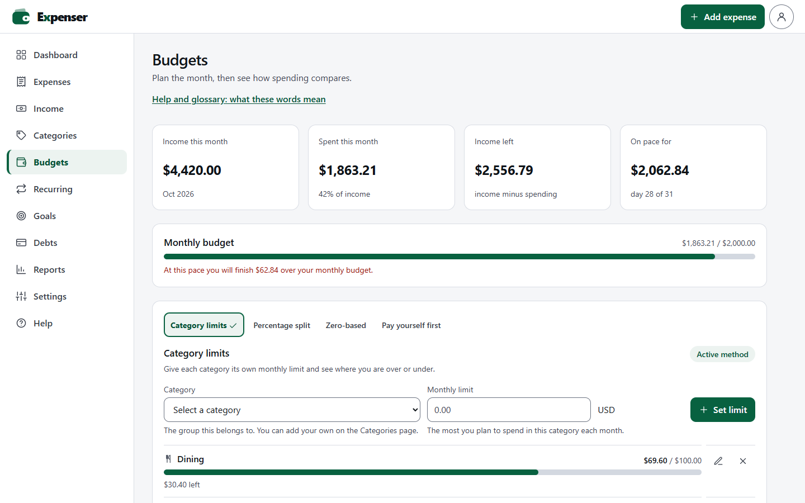
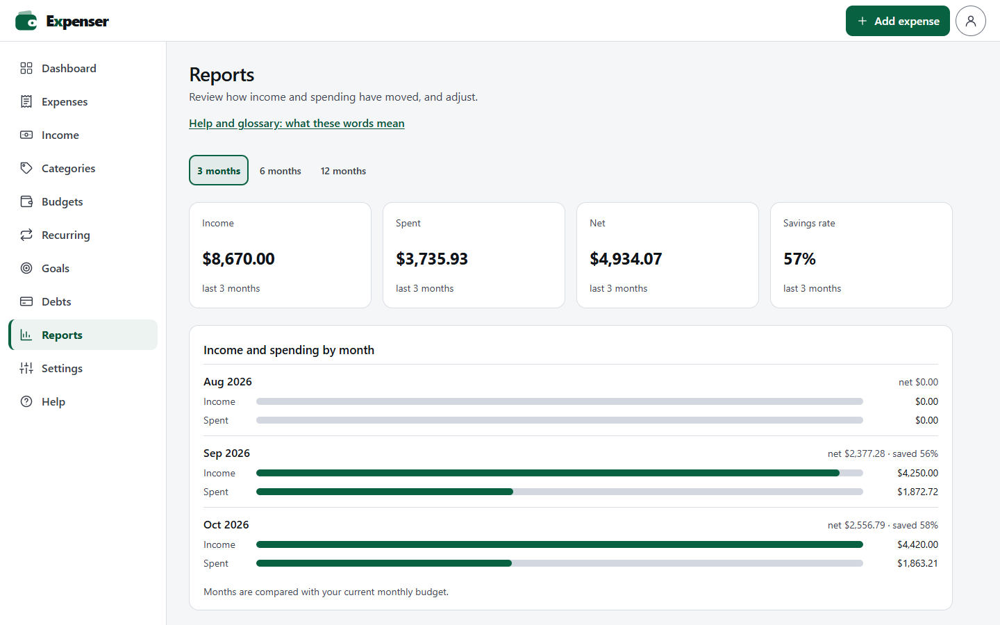
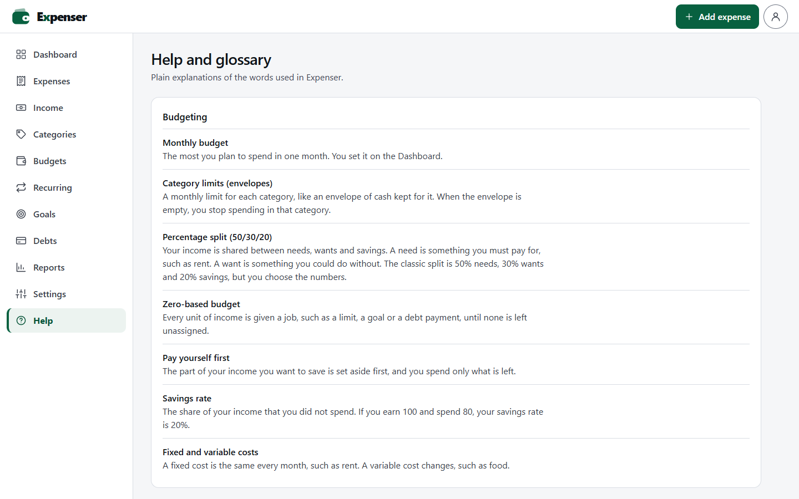

# Expenser

A personal expense tracker. Log what you spend, organise it into categories, set a monthly budget, and see how the current month compares to the last. Amounts can be entered in different currencies and are converted using live exchange rates.

## Try it

**Live demo: <https://expenser-weeu.onrender.com>** – nothing to install. Sign in as `guest1` or `guest2` (the password for both is `password`), create your own account, or choose **Try the demo without an account** for a **private sandbox** pre-filled with demo expenses, so you can click around freely. The two guest accounts are shared, so what you add to one is visible to everyone who signs in with it. Use **Settings → Reset demo data** to start over. Sandboxes are deleted after a week of inactivity.

The demo runs on a free hosting tier that sleeps when idle, so the first load can take about 30 seconds.

To run it yourself with one command and no database account (needs [Docker](https://www.docker.com/)):

```bash
docker compose up --build
```

Then open <http://localhost:5181>. The compose file also runs the app in demo mode (see [How the demo sandboxes work](#how-the-demo-sandboxes-work)). To host your own copy, see [Deploying](#deploying).

## Screenshots

**Dashboard** – this month's spending, budget left, top category, income, savings rate and recent expenses.


**Budgets** – pick a budgeting method (category limits, percentage split, zero-based or pay yourself first) and see how spending compares with the pace of the month.



**Reports** – income, spending, net and savings rate month by month.



**Categories** – create, sort and delete the labels you group spending by, each default with its own icon.


**Help and glossary** – plain explanations of the financial words used in the app.



**Settings (dark theme)** – choose the language, theme and display currency.


## Features

- **Accounts** – register with a username and password, or sign in with Google or GitHub. Everyone has their own private page: their own expenses, budgets, goals and settings, which nobody else can read. Change your password, sign out of your other devices, or delete your account and everything in it from **Settings**. See [Accounts and sign-in](#accounts-and-sign-in).
- **Dashboard** – spending for the current month, change versus last month, number of transactions, top category, budget progress and the five most recent expenses.
- **Expenses** – add and delete expenses with a title, category, optional description, date, currency and amount.
- **Categories** – create and delete your own categories (ten defaults are added on first run). Each default has its own icon and is shown in the language you picked; your own categories are shown as typed. Names are unique ignoring case. Deleting a category never changes existing expenses.
- **Monthly budget** – set a budget from the dashboard; it is stored in the currency you chose.
- **Income** – record money coming in, in any supported currency. The dashboard then shows income, what is left, and your savings rate for the month.
- **Budgeting methods** – the **Budgets** page supports four ways of planning the month, and you pick the active one: *category limits* (a monthly limit per category, with over/under for each), a *percentage split* between needs, wants and savings (50/30/20 pre-fills the form, but the percentages are yours), *zero-based* (income minus category limits, savings goals, minimum debt payments and yearly-bill set-asides, until nothing is unassigned) and *pay yourself first* (a savings share comes off income, the rest is what you can spend). It also shows where this month is heading at the current pace, and how spending splits between fixed and variable costs. Categories you push past their limit are listed on the dashboard.
- **Fixed/variable and need/want** – classify each category on the **Categories** page. Nothing is classified for you, and anything left unclassified is reported as such.
- **Recurring** – bills, subscriptions and paychecks that repeat weekly, monthly or yearly. When a date arrives the matching expense or income is added automatically (a start date in the past adds what was missed). Yearly bills show the monthly amount to set aside, as a sinking fund.
- **Goals** – savings goals with an optional deadline (it works out what to save each month) and an emergency fund whose target is the number of months of *your own* average spending you choose. Deposit and withdraw at any time.
- **Debts** – track balance, rate and minimum payment, record payments, and compare the avalanche (highest rate first) and snowball (smallest balance first) payoff orders, with an optional extra monthly payment. Interest is not added to the balance automatically, so edit the balance to match a statement; a payment larger than the balance is rejected.
- **Reports** – income, spending, net and savings rate for the last 3, 6 or 12 months, month by month and by category, compared with the month before.
- **Multiple currencies** – SEK, EUR, GBP, JPY, USD and TWD. Totals on the dashboard are converted into your display currency using daily rates from [open.er-api.com](https://www.exchangerate-api.com) (no API key needed). Rates are cached for 6 hours, and the last good copy is used if the provider is unreachable.
- **Languages** – English, Svenska, 日本語 and 繁體中文（台灣）. The browser language is detected on first visit; change it any time in **Settings**.
- **Accessibility** – built to WCAG 2.2 level AAA wherever an app can: 7:1 text contrast, 44 px targets, a skip link, a visible focus ring, keyboard use everywhere, help text on the main form fields, confirmation before anything is deleted, a help and glossary page, and support for reduced motion, high contrast and 400 % zoom. See [docs/ACCESSIBILITY.md](docs/ACCESSIBILITY.md) for the criterion-by-criterion status and what has not been tested.
- **Light, dark or match-system theme**, remembered between visits. Choose it in **Settings**.
- **Default entry currency** – in **Settings**, choose the currency new expenses, income, recurring items, goals and debts start in (it follows the display currency until you pick one). You can still change it on each form.
- **Backup and restore** – in **Settings**, download everything as a JSON backup, or just the expenses or income as CSV for a spreadsheet. A backup can be restored later, which replaces the current data; a file is fully checked first, so a bad one changes nothing. **Delete all my data** empties the app and leaves the default categories.
- **Exchange-rate status** – **Settings** shows the date of the rates in use and when they were last checked, warns when the provider can't be reached and the last saved rates are being used, and has a **Refresh rates** button.

None of the new features ship with sample amounts: income, category limits, goals, debts and recurring items start empty and hold only what you enter.

## Tech stack

| Layer    | Tools                                                  |
| -------- | ------------------------------------------------------ |
| Frontend | React 19, TypeScript, Vite, Tailwind CSS 4             |
| Backend  | Node.js, Express 5, Mongoose                           |
| Database | MongoDB (Atlas or a local instance)                    |

## Prerequisites

- **Node.js 24** or newer. The API server runs its TypeScript directly with `node` and loads `.env` with `--env-file`, so no separate compile step is needed.
- **A MongoDB database.** Either a free [MongoDB Atlas](https://www.mongodb.com/atlas) cluster or a local server at `mongodb://localhost:27017`.

## Getting started

1. **Install dependencies**

   ```bash
   npm install
   ```

2. **Configure the environment**

   Copy the example file and fill in your values:

   ```bash
   cp .env.example .env        # macOS / Linux / Git Bash
   copy .env.example .env      # Windows cmd
   ```

   | Variable        | Required | Description                                                                                          |
   | --------------- | -------- | ---------------------------------------------------------------------------------------------------- |
   | `MONGODB_URI`   | yes      | MongoDB connection string. For Atlas: *Connect → Drivers*. For local: `mongodb://localhost:27017`.   |
   | `MONGODB_DB`    | no       | Database name (default from the example: `expense-tracker`). Created automatically on first write.   |
   | `PORT`          | no       | Port for the API server. Defaults to `5181`; Vite proxies `/api` to it.                              |
   | `DEMO_MODE`     | no       | `true` turns on per-visitor demo sandboxes (see [below](#how-the-demo-sandboxes-work)). Leave it unset for development and personal use. |
   | `DNS_SERVERS`   | no       | Comma-separated DNS servers for Node, e.g. `8.8.8.8,1.1.1.1`. See [Troubleshooting](#troubleshooting). |
   | `APP_URL`       | in production | The public address of the app, e.g. `https://expenser.example.com`. Where the app is reached from: the token issuer, and the base of the Google and GitHub redirect addresses. Without it the address of each request is used. |
   | `OAUTH_SIGNING_KEY` | production | The key access tokens are signed with; see [Accounts and sign-in](#accounts-and-sign-in). Without it one is created and kept in the database. |
   | `OAUTH_ACCESS_TTL` | no   | How long an access token lasts, in seconds. Default `900`. |
   | `TRUST_PROXY`   | behind a proxy | Number of reverse proxies in front of the server (`1` on Render). Without it the sign-in rate limits see every visitor as the proxy. |
   | `SEED_GUESTS`   | no       | `false` stops the shared `guest1` and `guest2` accounts being created. Set it for a deployment with real users. |
   | `GOOGLE_CLIENT_ID`, `GOOGLE_CLIENT_SECRET`, `GITHUB_CLIENT_ID`, `GITHUB_CLIENT_SECRET` | no | Turn on "Continue with Google" / "Continue with GitHub". See [Accounts and sign-in](#accounts-and-sign-in). |

   `.env` is gitignored, so your credentials stay out of the repository.

3. **Start the app**

   ```bash
   npm run dev
   ```

   This runs the Vite dev server and the API server together. Open the URL Vite prints (usually <http://localhost:5180>).

   If you change `PORT`, also update the proxy target in [vite.config.ts](vite.config.ts).

4. **Sign in**

   The first start creates two demo accounts with sample data: **`guest1`** and **`guest2`**, both with the password **`password`**. Or choose **Create account**. If you used the app before accounts existed, your old data belongs to nobody yet: register an account, then run `npm run claim-data -- <username>` to move it there.

## Accounts and sign-in

**Passwords.** Hashed with scrypt (32 MiB, per-password salt, the cost stored with each hash) and never logged or sent back. New passwords need 8 to 128 characters. There are no rules about symbols or digits, which is current NIST guidance. Signing in with an unknown username takes as long as a wrong password, and both give the same message.

**The OAuth server.** The app runs its own [OAuth 2.0](https://datatracker.ietf.org/doc/html/rfc6749) authorization server and is also the resource server: the API only answers to an access token it issued. The web app is its one client (`expenser-web`, a public client). Signing in works like this:

1. The person proves who they are with a username and password (or Google / GitHub, below). The server leaves a sign-in cookie, which only the authorization server looks at.
2. The app sends the browser to `GET /api/oauth/authorize` with a [PKCE](https://datatracker.ietf.org/doc/html/rfc7636) challenge and a `state`. The server sees the cookie, and sends the browser back to `/auth/callback` with a one-time `code`.
3. The app posts the code and its PKCE secret to `POST /api/oauth/token` and gets an **access token** in the response. The **refresh token** arrives in an `HttpOnly` cookie instead, so no script on the page can ever read it.
4. Every API call carries `Authorization: Bearer <access token>`. The cookie is never accepted by the API, so a cross-site request can't ride on it.

Only the authorization code flow with S256 PKCE is offered: no implicit flow, no password grant. A code works once, for a minute. Redirect addresses must match exactly, and an unknown client or address is shown an error instead of being redirected.

**Tokens.**

| | What it is | Lifetime | Kept |
| - | - | - | - |
| Access token | A signed JWT ([RFC 9068](https://datatracker.ietf.org/doc/html/rfc9068), Ed25519), checked on every request without a database lookup of the token itself. | 15 minutes (`OAUTH_ACCESS_TTL`, in seconds) | In the page's memory only |
| Refresh token | A random single-use secret; only its SHA-256 is stored on the server. | 30 days after last use with "keep me signed in", otherwise until the browser closes; never more than 90 days after sign-in | In an `HttpOnly`, `SameSite=Strict` cookie that is only sent to `/api/oauth/*`. The page never handles it |

Refresh tokens **rotate**: every refresh retires the old one and issues a new one. If a retired token is ever used again (it was copied), the whole sign-in is revoked, the thief's and the owner's alike, and the owner signs in again. Two tabs refreshing at once are tolerated for 10 seconds, so ordinary use doesn't trigger that. Replaying a used authorization code revokes what it produced, too. Signing out revokes the refresh token on the server; "Sign out of other devices" and changing the password revoke every other sign-in. Because an access token is stateless it can't be taken back, so it works until it expires (at most 15 minutes), except that the account is looked up on each request, so deleting an account ends its tokens at once.

**Cross-site scripting.** The refresh token is the long-lived credential, so it is kept out of JavaScript's reach: it is never in a response body, in storage, or in `document.cookie`, and the browser attaches it to the token request by itself. A script injected into the page therefore can't take it away and use it later or elsewhere. What it can still do is act while the page is open: it can make same-origin requests, including asking the token endpoint for an access token (which it then holds for at most 15 minutes), because the browser sends the cookie with them. No design for a web app removes that, so the page also runs under a strict Content-Security-Policy with no inline scripts, no third-party code and no `eval`, to make an injection hard in the first place. The cookie is `SameSite=Strict` and the server also refuses cross-site requests that change something, so another site can't use it. Only a flag saying you were signed in (`expenser.signed-in`) is kept in `localStorage`, so the app knows whether a refresh is worth trying; it isn't a credential.

**Signing keys.** Access tokens are signed with an Ed25519 key. By default the server creates one on first start and keeps it in the database, so every instance agrees. For production, set `OAUTH_SIGNING_KEY` to an Ed25519 private key in PKCS#8 PEM form so the key stays out of database backups. Make one with `node -e "console.log(require('crypto').generateKeyPairSync('ed25519').privateKey.export({type:'pkcs8',format:'pem'}))"` and paste all of it as the value (hosting dashboards take the line breaks; in a `.env` file write each one as `
`). Changing the key signs everyone out of their access tokens (refresh tokens still work). The public key is at `GET /api/oauth/jwks` and the server's settings at `GET /.well-known/oauth-authorization-server` ([RFC 8414](https://datatracker.ietf.org/doc/html/rfc8414)).

**Other apps.** Only the web app can get tokens today. Adding another client means adding it in [server/oauth/clients.ts](server/oauth/clients.ts), a consent screen in `/authorize` for it (the web app skips consent because it is the same app), and, if it can keep a secret, client authentication at the token endpoint. A client that isn't a browser sets `refreshTokenInCookie: false` and gets its refresh token in the response body, which is what a program with no cookie jar needs.

**Abuse.** Failed sign-ins are limited per address and per address-and-username, registrations per address, failed token requests per address, and password-confirmation attempts per account. The limits are held in memory, so with several server instances each has its own count. A browser request that changes something and comes from another site is refused. The server sends a strict Content-Security-Policy, `nosniff`, `X-Frame-Options: DENY` and HSTS over HTTPS, and every response about an account or data is `no-store`.

**Google and GitHub.** An optional second way to prove who you are in step 1 above; the app's own tokens are issued either way. Here this server is the OAuth *client*: it uses the authorization code flow with PKCE and a `state` check, and exchanges the code on the server using the client secret, so no Google or GitHub token ever reaches the browser. A provider appears on the sign-in page once both its variables are set:

| Provider | Create the app at | Redirect URI to register |
| -------- | ----------------- | ------------------------ |
| Google   | [Google Cloud console → APIs & Services → Credentials](https://console.cloud.google.com/apis/credentials) (OAuth client ID, type *Web application*) | `<APP_URL>/api/auth/oauth/google/callback` |
| GitHub   | [GitHub → Settings → Developer settings → OAuth Apps](https://github.com/settings/developers) | `<APP_URL>/api/auth/oauth/github/callback` |

In development `<APP_URL>` is the Vite address, `http://localhost:5180`. An account is matched by the provider's own account id, **never by email**: matching by email would let anyone who registers with someone else's address take over that person's account. The first time someone signs in with a provider a new account is made, with a username taken from their name. Provider accounts have no password.

**Injection.** The app has no SQL: it stores data in MongoDB, so the injection to guard against is *operator injection*. A client that sends `{"username": {"$ne": null}}` where text is expected can turn "equals this" into "is anything" if the value reaches a query as it arrived. Three layers stop it, so that one handler getting it wrong isn't enough:

1. **The edge.** Every request body and query string is checked before a route runs ([server/security.ts](server/security.ts)). A field name that is an operator or a path (`$ne`, `a.b`, `a[$gt]`, `__proto__`), or nesting more than 20 levels deep, gets a `400`. Values are untouched, so a title like "$5 lunch" is fine.
2. **The query layer.** Mongoose runs with `sanitizeFilter` ([server/db.ts](server/db.ts)): an operator object inside a query filter is treated as a literal value and fails to cast, and `$where` is refused. The few filters the app writes itself that do use an operator are marked `trusted({ … })`, and only ever with values the server built.
3. **The handlers.** Each checks the type of what it uses (`typeof … === 'string'`, whole-number checks, `BUDGET_METHODS.includes`), and only named fields are copied from a body, so an extra `sandbox` or `_id` key can't redirect data into another account. Aggregation pipelines never include request text.

`npm run security` ([scripts/security/nosql-probe.mjs](scripts/security/nosql-probe.mjs)) checks all this against a running app with about 840 payloads, and it was itself tested by switching the defences off and confirming it fails.

**The demo accounts.** `guest1` and `guest2` are created once and never reset, so what people add to them stays until someone clears it. They can't be deleted and their password can't be changed. Their password is public, so for a deployment with real users set `SEED_GUESTS=false`.

**Not included yet.** There is no "forgot my password" email, email verification or two-factor sign-in, because there is no way to send email from this app. Until there is, a password-account holder who forgets their password cannot recover the account.

## Deploying

The API server also serves the built frontend, so the whole app is one Node process on one URL.

```bash
npm run build   # builds the frontend into dist/
npm start       # serves the API and dist/ on $PORT (default 5181)
```

### Render (free tier)

1. Create a free [MongoDB Atlas](https://www.mongodb.com/atlas) cluster and a database user used only for this demo. Under *Network Access* allow `0.0.0.0/0`, because Render's free tier has no fixed IP address.
2. In Render choose **New → Blueprint**, pick this repository, and paste the Atlas connection string as `MONGODB_URI` when asked. [render.yaml](render.yaml) configures everything else, including a separate `expenser-demo` database.
3. Once it's live, Render shows the app's URL on the service page. The live demo above was deployed this way.

The free tier sleeps after 15 minutes without traffic, so the first request afterwards takes about 30 seconds. Open the link yourself shortly before sharing it.

### Docker

[Dockerfile](Dockerfile) builds the frontend and runs the server; the image needs `MONGODB_URI` (and optionally `MONGODB_DB`, `PORT`) at runtime. [docker-compose.yml](docker-compose.yml) adds a MongoDB container for local use.

### How the demo sandboxes work

Sandboxes exist only when `DEMO_MODE=true`, which [render.yaml](render.yaml) and [docker-compose.yml](docker-compose.yml) set. Without it, which is the default for `npm run dev`, everyone needs an account, there are no sandboxes, no limits, and the reset endpoint doesn't exist.

In demo mode the sign-in page also offers **Try the demo without an account**. The browser then creates a random id, keeps it in `localStorage` and sends it as the `X-Sandbox-Id` header on every API call. The server scopes all reads and writes to that id and fills a new sandbox with demo data on first use. Anyone who knows an id can see that sandbox, so this is suitable for a demo, **not** for real financial data. A visitor who clears their browser data gets a fresh sandbox, and the old one is removed after a week. Signed-in people never use a sandbox: their data is stored under their account, and the demo caps (500 expenses and so on) and **Reset demo data** apply to them too.

## Scripts

| Command           | What it does                                                         |
| ----------------- | -------------------------------------------------------------------- |
| `npm run dev`     | Starts the client and the API server together.                       |
| `npm run client`  | Starts only the Vite dev server.                                     |
| `npm run server`  | Starts only the API server (restarts on file changes).               |
| `npm run build`   | Type-checks the project and builds the frontend into `dist/`.        |
| `npm run preview` | Serves the production build locally (the API server must also run). |
| `npm start`       | Runs the API server, which also serves `dist/` if it has been built.  |
| `npm run lint`    | Runs ESLint.                                                         |
| `npm test`        | Unit tests for password hashing, usernames, cookies, rate limiting, PKCE and token signing and checking (no database needed). |
| `npm run claim-data -- <username>` | Gives data saved before accounts existed to an empty account. |
| `npm run security` | Sends NoSQL-injection payloads at every endpoint of a running app and fails if any is accepted, causes a server error, leaks or changes another account's data; see [Injection](#injection). |
| `npm run a11y`    | Checks accessibility (colour contrast, axe-core WCAG rules, keyboard behaviour) against a running app; see [Accessibility checks](#accessibility-checks). |
| `npm run screenshots` | Retakes the images in `docs/screenshots/` from a running demo app (signs in as `guest1` and resets its sample data first; needs Chrome). |

## Accessibility checks

`npm run a11y` checks the colour tokens against AAA contrast, then opens every page in Chrome (light, dark and phone width) with [axe-core](https://github.com/dequelabs/axe-core), and finally tries the keyboard behaviour: skip link, focus after navigating, the confirm dialog, announcements and reflow. It also checks the sign-in and registration pages and the account menu. It signs in as `guest1` and resets that account's sample data before each run, so it needs Chrome installed (or `CHROME_PATH` pointing at a browser) and the app running with demo data:

```bash
npm run build
DEMO_MODE=true npm start     # on Windows PowerShell: $env:DEMO_MODE='true'; npm start
npm run a11y                 # in another terminal; set BASE=http://localhost:PORT if the port is not 5181
```

It exits with an error if anything fails, so it can gate a change. Run it after touching colours, forms or layout.

## Project structure

```
server/
  index.ts          Express app, error handling, static frontend, startup
  db.ts             MongoDB connection
  sandbox.ts        Who a piece of data belongs to (an account or a demo sandbox): scope, seeding, reset, cleanup
  demo.ts           Default categories and demo expenses
  auth/             Passwords (scrypt), the sign-in cookie, rate limiting, sign-in with Google / GitHub, security headers, demo accounts; tests alongside
  oauth/            The authorization server: client registry, Ed25519 signing key, JWT access tokens, refresh-token rotation
  claimLegacyData.ts  `npm run claim-data`: gives pre-accounts data to an account
  rates.ts          Supported currencies, exchange-rate fetching/caching, conversion
  money.ts          Currency conversion and month helpers shared by the routes
  planning.ts       Month overview, goal and debt progress, category limits vs spending
  recurring.ts      Turns due recurring items into expenses / income
  debtPlan.ts       Avalanche and snowball payoff simulation
  models/           Mongoose models: User, Session, AuthCode, RefreshToken, SigningKey, Expense, Income, Category, CategoryBudget, Budget, Goal, Debt, Recurring
  routes/           API routes: auth, oauth, expenses, income, categories, budget, summary, goals, debts, recurring, reports, rates, data, sandbox
src/
  App.tsx           Shows the sign-in page, or the app once someone is signed in
  auth/             Sign-in state (AuthProvider, useAuth), the OAuth client (tokens.ts: PKCE, refresh) and the server's error codes
  pages/            Auth (sign in / register), Dashboard, Expenses, Income, Categories, Budgets (and budgets/ method panels), Recurring, Goals, Debts, Reports, Settings (and settings/AccountCard), Help
  components/       Layout (sidebar, header) and shared UI components
  config/           Navigation items and the icon for each default category
  i18n/             Language/currency preferences and message files (en, sv, ja, zh-TW)
  lib/api.ts        Typed fetch helper and useApi hook
  lib/sandbox.ts    Anonymous-demo sandbox id (kept in localStorage, sent with every request)
  lib/route.ts      The current page, kept in the URL hash (#/expenses)
  hooks/            Theme hook
scripts/a11y/       Accessibility checks (`npm run a11y`): contrast, axe-core audit, keyboard behaviour
scripts/screenshots.mjs  Retakes the README screenshots (`npm run screenshots`)
docs/               Screenshots and the accessibility statement
```

## API

All routes are under `/api`. Every request except `/api/health`, `/api/auth/*`, `/api/oauth/*` and `GET /api/rates` needs an access token (`Authorization: Bearer …`, from [the OAuth server](#accounts-and-sign-in)), and the data you read and write belongs to that account. Without a token the API answers `401` with `{ "error": "...", "code": "unauthorized" }`; with one that is bad or expired, `401` with `"code": "invalid_token"` and a `WWW-Authenticate` header, which is the cue to refresh it. In demo mode only, a request without a token may send an `X-Sandbox-Id` header containing a UUID instead, and its data belongs to that id (see [How the demo sandboxes work](#how-the-demo-sandboxes-work)). A browser request that changes something and comes from another site gets `403`. Amounts are integers in minor units (cents), i.e. the displayed value × 100 — including for JPY.

| Method & path             | Description                                                                                         |
| ------------------------- | --------------------------------------------------------------------------------------------------- |
| `GET /api/health`         | `200` when connected to MongoDB, otherwise `503`. Includes `demo`, whether demo mode is on.         |
| `GET /api/auth/session`   | Looks at the sign-in cookie. Always `200`: `user` (or `null` if nobody is signed in), the `providers` that are set up, and `demo`. |
| `GET /api/auth/me`        | Needs an access token. The signed-in `user`.                                                       |
| `POST /api/auth/register` | Create an account and leave the sign-in cookie (tokens come from `/api/oauth/authorize` and `/token`): `username` (3–30 letters, numbers, `.` `-` `_`), `password` (8–128 characters), `remember?`. `400` with a `code` (`username_invalid`, `username_reserved`, `password_short`, `password_long`, `password_username`), `409` `username_taken`, `429` `too_many_attempts`. |
| `POST /api/auth/login`    | Check the password and leave the sign-in cookie: `username` (any case), `password`, `remember?`. `401` `invalid_credentials` for a wrong password or unknown user alike; `429` after too many failures (with `Retry-After`). |
| `POST /api/auth/logout`   | End the sign-in cookie and drop the refresh cookie. `204`. (The app also revokes the refresh token on the server first, via `/api/oauth/revoke`.) |
| `POST /api/auth/logout-others` | Needs an access token. Revoke every other sign-in of the account: refresh tokens and cookies. `204`. |
| `POST /api/auth/password` | Needs an access token. Change the password: `currentPassword`, `newPassword`. Revokes the other sign-ins. Not for the demo accounts or accounts without a password. |
| `DELETE /api/auth/account` | Needs an access token. Delete the account and all its data: `password`, or for a Google / GitHub account `confirm` set to the username. Not for the demo accounts. |
| `GET /api/auth/oauth/:provider/start`, `GET /api/auth/oauth/:provider/callback` | The two halves of Google / GitHub sign-in (`google`, `github`). They redirect, and a failure sends the browser back to `/?auth_error=…`. |
| `GET /api/oauth/authorize` | OAuth 2.0 authorization endpoint: `response_type=code`, `client_id=expenser-web`, `redirect_uri`, `state`, `code_challenge`, `code_challenge_method=S256`, `scope?` (`api`). Redirects to the redirect address with `code` and `state`, or with `error=login_required` if nobody is signed in. |
| `POST /api/oauth/token`   | Token endpoint (form-encoded). `grant_type=authorization_code` with `code`, `redirect_uri`, `code_verifier`; or `grant_type=refresh_token` (the refresh token is read from the `expenser_refresh` cookie, and anything in the body is ignored); both with `client_id`. Returns `access_token`, `token_type`, `expires_in`, `scope`, and sets the new refresh cookie. Errors are `{ error, error_description }` as RFC 6749 §5.2 describes. |
| `POST /api/oauth/revoke`  | Revoke the refresh token (RFC 7009) and drop its cookie. `client_id`; the token comes from the cookie. Always `200`. |
| `GET /api/oauth/jwks`, `GET /.well-known/oauth-authorization-server` | The public signing key, and the server's endpoints and capabilities (RFC 8414). |
| `GET /api/expenses`       | Latest expenses, newest first. Optional `limit` (default 200, max 500).                             |
| `POST /api/expenses`      | Create an expense (max 500 per sandbox in demo mode): `title`, `category` (must exist), `date`, `amountCents`, `currency`, `description?`. |
| `DELETE /api/expenses/:id`| Delete an expense.                                                                                  |
| `GET /api/categories`     | All categories, each with the number of expenses that use it.                                       |
| `POST /api/categories`    | Create a category: `name`. Returns `409` if it already exists.                                      |
| `DELETE /api/categories/:id` | Delete a category.                                                                               |
| `GET /api/budget`         | The monthly budget (`monthlyCents`, `currency`).                                                    |
| `PUT /api/budget`         | Set the monthly budget: `monthlyCents`, `currency?`.                                                |
| `PUT /api/budget/method`  | Choose the budgeting method (`envelope`, `split`, `zeroBased`, `payFirst`) and its percentages: `split` needs `needsPercent`, `wantsPercent` and `savingsPercent` adding up to 100; `payFirst` needs `savingsPercent`. |
| `GET /api/budget/categories` | The per-category monthly limits.                                                                 |
| `PUT /api/budget/categories` | Set a category's monthly limit: `category` (must exist), `limitCents`, `currency?`.              |
| `DELETE /api/budget/categories/:id` | Remove a category limit.                                                                  |
| `GET /api/budget/overview` | This month's income, spending, savings, pace and per-category spending against limits, converted into `currency`. |
| `PATCH /api/categories/:id` | Classify a category: `costType` (`fixed`/`variable`) and/or `necessity` (`need`/`want`); `null` clears one. |
| `GET /api/income`, `POST /api/income`, `DELETE /api/income/:id` | List, add (`title`, `date`, `amountCents`, `currency`) and delete income. |
| `GET /api/goals`          | Goals with progress, converted into `currency`. An emergency fund's target is derived from average monthly spending. |
| `POST /api/goals`         | Create a goal: `name`, `kind` (`savings` needs `targetCents`, `deadline?`; `emergency` needs `targetMonths`), `currency`. |
| `POST /api/goals/:id/contributions` | Add money (`amountCents`) or take it out (negative); a goal cannot go below zero. `DELETE /api/goals/:id` removes a goal. |
| `GET /api/debts`          | Debts and both payoff plans, converted into `currency`. Optional `extra`: extra cents per month.   |
| `POST /api/debts`         | Create a debt: `name`, `balanceCents`, `aprPercent`, `minPaymentCents`, `currency`.                |
| `PATCH /api/debts/:id`    | Correct `balanceCents`, `aprPercent` or `minPaymentCents`. `POST /api/debts/:id/payments` records a payment; `DELETE /api/debts/:id` removes the debt. |
| `GET /api/recurring`      | Recurring items with their monthly equivalent, plus totals and the yearly-bill sinking fund.         |
| `POST /api/recurring`     | Create one: `kind` (`expense`/`income`), `title`, `amountCents`, `currency`, `frequency`, `startDate`, `category` (expenses). `PATCH /api/recurring/:id` with `active` pauses or resumes it; `DELETE` removes it. |
| `GET /api/reports`        | Income and spending per month and per category for the last `months` months (1–24, default 6).      |
| `GET /api/summary`        | Dashboard figures for the current month, converted into the `currency` query parameter (default `USD`). |
| `POST /api/sandbox/reset` | Demo mode only: replace the sandbox's data with a fresh copy of the demo data.                      |
| `GET /api/rates`          | Current exchange rates (base `USD`), when the provider dated them (`updatedAt`), when this server last fetched them (`fetchedAt`) and whether the provider was unreachable on the latest try so an older copy is used (`stale`). |
| `POST /api/rates/refresh` | Fetch the rates again now (at most once a minute; within that time the current ones are returned). Same response as `GET /api/rates`. Needs an access token. |
| `GET /api/data/export`    | Everything in the current dataset as one JSON backup (`app: "expenser"`, `version`, budget, categories, expenses, income, category limits, goals, debts, recurring). |
| `GET /api/data/export/expenses.csv`, `GET /api/data/export/income.csv` | The expenses or the income as CSV (UTF-8 with a byte-order mark; amounts in major units, text that starts like a formula is prefixed with `'`). |
| `POST /api/data/import`   | Replace the current data with a backup in the format above. Every row is validated first; a bad file returns `400` and changes nothing. In demo mode the usual caps apply. |
| `DELETE /api/data`        | Delete everything in the current dataset and restore the default categories.                       |

Due recurring items are turned into expenses and income whenever the data is read, so no scheduler is needed.

In demo mode a malformed `X-Sandbox-Id` returns `400`. Validation errors also return `400` with `{ "error": "..." }`. If exchange rates can't be fetched and none are cached, the API returns `503`.

## Troubleshooting

- **`MONGODB_URI is not set`** – you haven't created `.env`. Copy `.env.example` to `.env` and fill it in.
- **`querySrv ECONNREFUSED` when connecting to Atlas** – your network or VPN is blocking the SRV DNS lookup that `mongodb+srv://` URIs need. Uncomment `DNS_SERVERS=8.8.8.8,1.1.1.1` in `.env`.
- **Connection times out** – with Atlas, make sure your current IP address is allowed under *Network Access*, and that the username and password in the URI are correct (special characters in the password must be URL-encoded).
- **The page loads but shows errors fetching data** – check that the API server is running (`npm run dev` starts both) and that `http://localhost:5181/api/health` responds.
- **Signed out straight away, or "Too many attempts" for everyone, in production** – the server is behind a reverse proxy and doesn't know it. Set `TRUST_PROXY=1` (and `APP_URL` to the public https address) so it sees the real protocol and visitor address.
- **"Continue with Google" returns to the sign-in page with a message** – the redirect URI registered with Google or GitHub must match `<APP_URL>/api/auth/oauth/<provider>/callback` exactly. The server log has the provider's reason.
- **`npm install` fails with a certificate error** – on a network with a corporate proxy, point the local `.npmrc` at your organisation's CA file: `cafile=C:\path\to\corporate-ca.pem`. `.npmrc` is gitignored.
