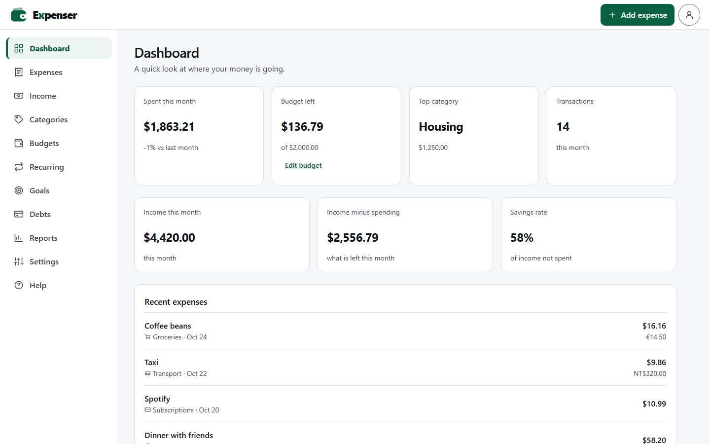
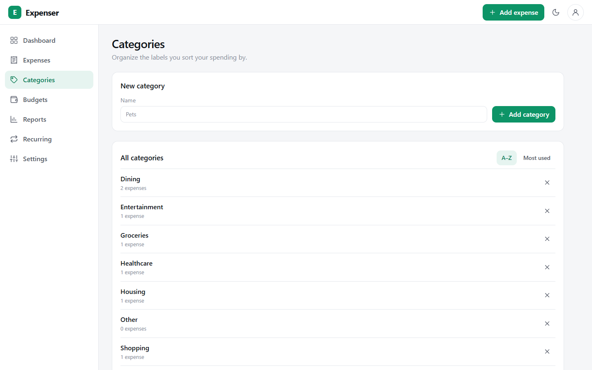
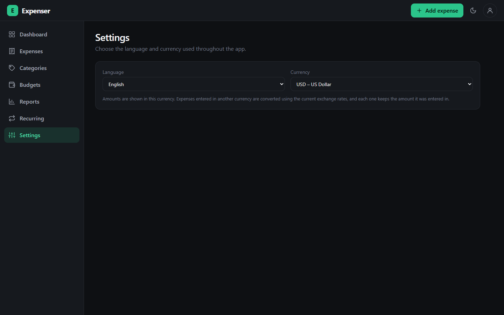

# Expenser

A personal expense tracker. Log what you spend, organise it into categories, set a monthly budget, and see how the current month compares to the last. Amounts can be entered in different currencies and are converted using live exchange rates.

## Try it

Run it with one command and no database account (needs [Docker](https://www.docker.com/)):

```bash
docker compose up --build
```

Then open <http://localhost:5181>. To put it on the internet so others can use it, see [Deploying](#deploying).

The compose file runs the app in **demo mode** (see below): every visitor gets a **private sandbox** pre-filled with demo expenses, so there's nothing to set up and nobody sees anyone else's data. Use **Settings → Reset demo data** to start over. Sandboxes are deleted after a week of inactivity.

## Screenshots

**Dashboard** – this month's spending, budget left, top category and recent expenses.



**Categories** – create, sort and delete the labels you group spending by.



**Settings (dark theme)** – choose the language and display currency.



## Features

- **Dashboard** – spending for the current month, change versus last month, number of transactions, top category, budget progress and the five most recent expenses.
- **Expenses** – add and delete expenses with a title, category, optional description, date, currency and amount.
- **Categories** – create and delete your own categories (ten defaults are added on first run). Names are unique ignoring case. Deleting a category never changes existing expenses.
- **Monthly budget** – set a budget from the dashboard; it is stored in the currency you chose.
- **Multiple currencies** – SEK, EUR, GBP, JPY, USD and TWD. Totals on the dashboard are converted into your display currency using daily rates from [open.er-api.com](https://www.exchangerate-api.com) (no API key needed). Rates are cached for 6 hours, and the last good copy is used if the provider is unreachable.
- **Languages** – English, Svenska, 日本語 and 繁體中文（台灣）. The browser language is detected on first visit; change it any time in **Settings**.
- **Light/dark theme**, remembered between visits.

The **Budgets**, **Reports** and **Recurring** pages are placeholders for now.

## Tech stack

| Layer    | Tools                                                  |
| -------- | ------------------------------------------------------ |
| Frontend | React 19, TypeScript, Vite, Tailwind CSS 4             |
| Backend  | Node.js, Express 5, Mongoose                           |
| Database | MongoDB (Atlas or a local instance)                    |

## Prerequisites

- **Node.js 24** or newer. The API server runs its TypeScript directly with `node` and loads `.env` with `--env-file`, so no separate compile step is needed.
- **A MongoDB database.** Either a free [MongoDB Atlas](https://www.mongodb.com/atlas) cluster or a local server at `mongodb://localhost:27017`.

## Getting started

1. **Install dependencies**

   ```bash
   npm install
   ```

2. **Configure the environment**

   Copy the example file and fill in your values:

   ```bash
   cp .env.example .env        # macOS / Linux / Git Bash
   copy .env.example .env      # Windows cmd
   ```

   | Variable        | Required | Description                                                                                          |
   | --------------- | -------- | ---------------------------------------------------------------------------------------------------- |
   | `MONGODB_URI`   | yes      | MongoDB connection string. For Atlas: *Connect → Drivers*. For local: `mongodb://localhost:27017`.   |
   | `MONGODB_DB`    | no       | Database name (default from the example: `expense-tracker`). Created automatically on first write.   |
   | `PORT`          | no       | Port for the API server. Defaults to `5181`; Vite proxies `/api` to it.                              |
   | `DEMO_MODE`     | no       | `true` turns on per-visitor demo sandboxes (see [below](#how-the-demo-sandboxes-work)). Leave it unset for development and personal use. |
   | `DNS_SERVERS`   | no       | Comma-separated DNS servers for Node, e.g. `8.8.8.8,1.1.1.1`. See [Troubleshooting](#troubleshooting). |

   `.env` is gitignored, so your credentials stay out of the repository.

3. **Start the app**

   ```bash
   npm run dev
   ```

   This runs the Vite dev server and the API server together. Open the URL Vite prints (usually <http://localhost:5180>).

   If you change `PORT`, also update the proxy target in [vite.config.ts](vite.config.ts).

## Deploying

The API server also serves the built frontend, so the whole app is one Node process on one URL.

```bash
npm run build   # builds the frontend into dist/
npm start       # serves the API and dist/ on $PORT (default 5181)
```

### Render (free tier)

1. Create a free [MongoDB Atlas](https://www.mongodb.com/atlas) cluster and a database user used only for this demo. Under *Network Access* allow `0.0.0.0/0`, because Render's free tier has no fixed IP address.
2. In Render choose **New → Blueprint**, pick this repository, and paste the Atlas connection string as `MONGODB_URI` when asked. [render.yaml](render.yaml) configures everything else, including a separate `expenser-demo` database.
3. Once it's live, add the URL to the top of this README and to the repository description.

The free tier sleeps after 15 minutes without traffic, so the first request afterwards takes about 30 seconds. Open the link yourself shortly before sharing it.

### Docker

[Dockerfile](Dockerfile) builds the frontend and runs the server; the image needs `MONGODB_URI` (and optionally `MONGODB_DB`, `PORT`) at runtime. [docker-compose.yml](docker-compose.yml) adds a MongoDB container for local use.

### How the demo sandboxes work

Sandboxes exist only when `DEMO_MODE=true`, which [render.yaml](render.yaml) and [docker-compose.yml](docker-compose.yml) set. Without it, which is the default for `npm run dev`, there is a single dataset (yours), no demo data, no limits, and the reset endpoint doesn't exist.

In demo mode there are no accounts. The browser creates a random id, keeps it in `localStorage` and sends it as the `X-Sandbox-Id` header on every API call. The server scopes all reads and writes to that id and fills a new sandbox with demo data on first use. Anyone who knows an id can see that sandbox, so this is suitable for a demo, **not** for real financial data. A visitor who clears their browser data gets a fresh sandbox, and the old one is removed after a week.

## Scripts

| Command           | What it does                                                         |
| ----------------- | -------------------------------------------------------------------- |
| `npm run dev`     | Starts the client and the API server together.                       |
| `npm run client`  | Starts only the Vite dev server.                                     |
| `npm run server`  | Starts only the API server (restarts on file changes).               |
| `npm run build`   | Type-checks the project and builds the frontend into `dist/`.        |
| `npm run preview` | Serves the production build locally (the API server must also run). |
| `npm start`       | Runs the API server, which also serves `dist/` if it has been built.  |
| `npm run lint`    | Runs ESLint.                                                         |

## Project structure

```
server/
  index.ts          Express app, error handling, static frontend, startup
  db.ts             MongoDB connection
  sandbox.ts        Per-visitor sandboxes: middleware, demo seeding, reset, cleanup
  demo.ts           Default categories and demo expenses
  rates.ts          Supported currencies, exchange-rate fetching/caching, conversion
  models/           Mongoose models: Expense, Category, Budget
  routes/           API routes: expenses, categories, budget, summary, rates, sandbox
src/
  App.tsx           Page switching
  pages/            Dashboard, Expenses, Categories, Settings, Placeholder
  components/       Layout (sidebar, header) and shared UI components
  i18n/             Language/currency preferences and message files (en, sv, ja, zh-TW)
  lib/api.ts        Typed fetch helper and useApi hook
  lib/sandbox.ts    Demo-mode sandbox id (kept in localStorage, sent with every request)
  hooks/            Theme hook
```

## API

All routes are under `/api`. In demo mode only, every request except `/api/health` and `/api/rates` needs an `X-Sandbox-Id` header containing a UUID, and the data you read and write belongs to that id (see [How the demo sandboxes work](#how-the-demo-sandboxes-work)). Amounts are integers in minor units (cents), i.e. the displayed value × 100 — including for JPY.

| Method & path             | Description                                                                                         |
| ------------------------- | --------------------------------------------------------------------------------------------------- |
| `GET /api/health`         | `200` when connected to MongoDB, otherwise `503`. Includes `demo`, whether demo mode is on.         |
| `GET /api/expenses`       | Latest expenses, newest first. Optional `limit` (default 200, max 500).                             |
| `POST /api/expenses`      | Create an expense (max 500 per sandbox in demo mode): `title`, `category` (must exist), `date`, `amountCents`, `currency`, `description?`. |
| `DELETE /api/expenses/:id`| Delete an expense.                                                                                  |
| `GET /api/categories`     | All categories, each with the number of expenses that use it.                                       |
| `POST /api/categories`    | Create a category: `name`. Returns `409` if it already exists.                                      |
| `DELETE /api/categories/:id` | Delete a category.                                                                               |
| `GET /api/budget`         | The monthly budget (`monthlyCents`, `currency`).                                                    |
| `PUT /api/budget`         | Set the monthly budget: `monthlyCents`, `currency?`.                                                |
| `GET /api/summary`        | Dashboard figures for the current month, converted into the `currency` query parameter (default `USD`). |
| `POST /api/sandbox/reset` | Demo mode only: replace the sandbox's data with a fresh copy of the demo data.                      |
| `GET /api/rates`          | Current exchange rates (base `USD`) and when the provider last updated them.                        |

In demo mode a missing or malformed `X-Sandbox-Id` returns `400`. Validation errors also return `400` with `{ "error": "..." }`. If exchange rates can't be fetched and none are cached, the API returns `503`.

## Troubleshooting

- **`MONGODB_URI is not set`** – you haven't created `.env`. Copy `.env.example` to `.env` and fill it in.
- **`querySrv ECONNREFUSED` when connecting to Atlas** – your network or VPN is blocking the SRV DNS lookup that `mongodb+srv://` URIs need. Uncomment `DNS_SERVERS=8.8.8.8,1.1.1.1` in `.env`.
- **Connection times out** – with Atlas, make sure your current IP address is allowed under *Network Access*, and that the username and password in the URI are correct (special characters in the password must be URL-encoded).
- **The page loads but shows errors fetching data** – check that the API server is running (`npm run dev` starts both) and that `http://localhost:5181/api/health` responds.
- **`npm install` fails with a certificate error** – on a network with a corporate proxy, point the local `.npmrc` at your organisation's CA file: `cafile=C:\path\to\corporate-ca.pem`. `.npmrc` is gitignored.
